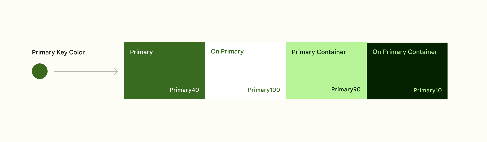
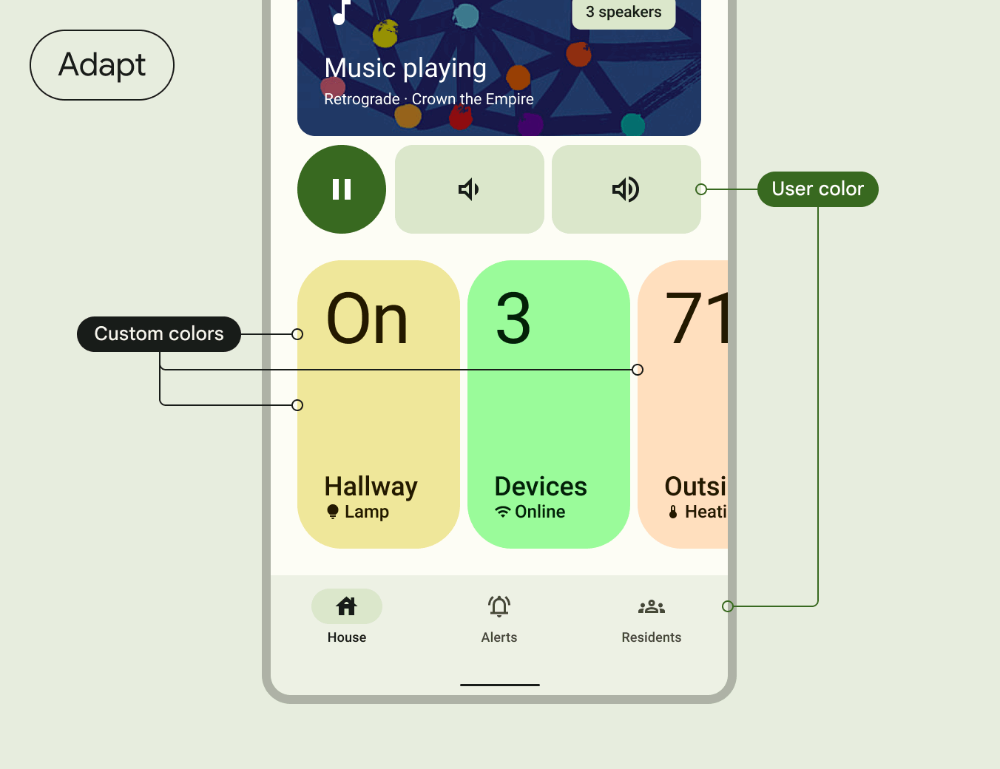

Web 向けの Material 3 ライブラリは[こちらのページ](https://m3.material.io/develop/web)によると、現在「対応予定」となってます。
ただ、Flutter でも使用されている新しい Color System を実装するライブラリの NPM 版が公開されています。
こちらを使用すれば、Web アプリにも Material 3 の Color System だけ導入できます。

Material 3 の Color System についての公式ドキュメントはこちら。

https://m3.material.io/styles/color/overview

## インストール

[`@material/material-color-utilities`](https://www.npmjs.com/package/@material/material-color-utilities) になります。

```sh
$ npm install @material/material-color-utilities
```

この記事では、公開時点で最新の `v0.2.0` を使用しています。

## テーマを生成する

`themeFromSourceColor` でシードカラーから、`themeFromImage` で画像からテーマを生成できます。

```typescript
const seedColor = 0x6750a4;
const theme = themeFromSourceColor(seedColor);

const image = new Image();
const theme = themeFromImage(image);
```

第二引数では、カスタムカラーを追加できます。

```typescript
themeFromSourceColor(seedColor, [
  {
    name: "custom-color",
    value: 0xff0000,
  },
]);
```

カスタムカラーは単にテーマへ key:value で追加されるわけではなく、テキストカラーやコンテナカラーも一緒に生成される仕組みです。



> [Color rules](https://m3.material.io/styles/color/the-color-system/color-roles) より

また `blend` オプションを渡すことで、[Harmonization](https://m3.material.io/styles/color/the-color-system/custom-colors#0a23e6c1-3a6b-490d-a6b6-b7bce64314e2) という仕組みも適用できます。

```diff ts
 themeFromSourceColor(seedColor, [
   {
     name: "custom-color",
     value: 0xff0000,
+    blend: true,
   },
 ]);
```

Harmonization を適用すると以下の画像のように、カスタムカラーを少しシードカラーに寄せることで、アプリの色合いにまとまりを持たせます。



> [Harmonization](https://m3.material.io/styles/color/the-color-system/custom-colors#0a23e6c1-3a6b-490d-a6b6-b7bce64314e2) より

## テーマを使用する

生成したテーマは `applyTheme` 関数に渡すことで、CSS Variable として `<body>` に展開されます。
(カスタムカラーは展開されないため、追加で実装する必要があります。)

```typescript
applyTheme(theme);
applyTheme(theme, { dark: true }); // ダークテーマを適応する

applyTheme(theme, { target: document.documentElement }); // 展開先を変更する
```

各色には `--md-sys-color-` のプリフィックを付けてアクセスします。

```css
.foo {
  background-color: var(--md-sys-color-primary);
  color: var(--md-sys-color-on-primary);
}
```

CSS in JS などで直接アクセスする場合は以下のようになります。

スキームへのアクセス:

```typescript
const lightScheme = theme.schemes.light;
const darkScheme = theme.schemes.dark;

const lightPrimary = lightScheme.primary;
const lightOnPrimary = lightScheme.onPrimary;
```

カスタムカラーへのアクセス:
配列なのでそのままでは使いづらいかもしれません。

```typescript
const lightCustom = theme.customColors[0].light;
const darkCustom = theme.customColors[0].dark;

const lightCustomColor = lightCustom.color;
const lightCustomOnColor = lightCustom.onColor;
```

## サンプル

@[codesandbox](https://codesandbox.io/embed/m3-dynamic-color-ecuwb1)
